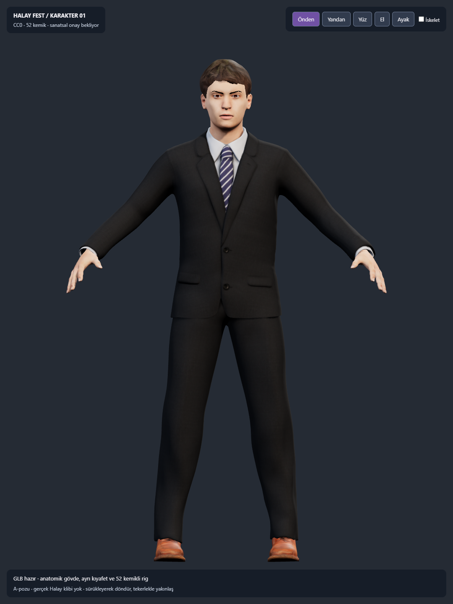

# Faz 2 — gerçek tek karakter teslimi

**15 Kasım 2026 · Sanatsal kabul bekliyor.** Dal `feat/phase-2-single-character-production`, başlangıç PR #5 / `da11f4f67b6da8ffa2b8c3629e706c51a403abf0`. PR #5 birleştirilmedi. Bu teslim bir araştırma panosu değil; Blender kaynağı, gerçek GLB ve Three.js'te çalışan tek karakterdir. Henüz Halay animasyonu veya altılı sahne değildir.

**16 Kasım 2026 teslim kontrolü:** yarım kalan GitHub gönderimi tamamlanırken kayıtlı production raporu kontrol edildi: 20 başarılı / 3 atlanan / 0 hatalı test. Model, Blender kaynağı, üretim script'i ve render kaynağının SHA-256 değerleri yeniden eşleştirildi. Üretim ve görüntüler 15 Kasım tarihlidir; testler bu kontrolde yeniden çalıştırılmış gibi sunulmaz.

## Dosyalar ve çalışan görüntü

| Somut çıktı | Yol / doğrulama |
|---|---|
| Düzenlenebilir Blender kaynak | [wedding-guest-01.blend](../assets/characters/wedding-guest-01/wedding-guest-01.blend), yaklaşık 20,9 MB. `AUTHORING` koleksiyonunda gövde/uyarlama shape key'leri, `RUNTIME` koleksiyonunda bake edilmiş ayrı mesh/rig. Eklenti etkin olmadan yeniden açıldı. |
| Oyun varlığı | [wedding-guest-01.glb](../apps/broadcaster/public/characters/production/wedding-guest-01.glb), yaklaşık 18,2 MB, gömülü dokular, 9 skinned mesh / 52 kemik, **0 animasyon klibi**. |
| Kaynak ve çıktı hash'leri | [build-info.json](../apps/broadcaster/public/characters/production/build-info.json); kaynak arşivi, MPFB commit'i, seçilmiş girdiler, Blender/GLB/script SHA-256. |
| Blender yeniden açma kontrolü | [source-validation.json](evidence/single-character/source-validation.json): 9 kaynak + 9 runtime mesh, 52 kemik, 10 packed image, eksik packed image yok, 14 authoring shape key / runtime 0. |
| Gerçek motor | http://127.0.0.1:5173/character.html; build önizlemesi http://127.0.0.1:4174/character.html. Three.js GLB yükleme, orbit/zoom, ön/yan, yüz/el/ayak ve iskelet görünümü. |
| Üretim komutu | `scripts/build-production-character.py`; Blender + MPFB + resmi System Assets gerekir. Normal runtime/CI hazır GLB kullanır. |
| Motor görüntüleme/ölçüm aracı | `node --import=tsx scripts/capture-production-character.ts`; önce `npm run dev`, yerel Chromium gerekir. Tek karakterle sınırlı. |

[Motor yandan](evidence/single-character/engine-side.png) · [Yüz](evidence/single-character/engine-face.png) · [El](evidence/single-character/engine-hands.png) · [Ayak/ayakkabı](evidence/single-character/engine-feet.png) · [İskelet](evidence/single-character/engine-rig.png).

[Blender/Cycles önden](evidence/single-character/blender-front.png) · [Blender/Cycles yandan](evidence/single-character/blender-side.png). Hepsi gerçek 3D renderdır; üretilmiş bitmap konsept veya rötuşlanmış sahte oyun görüntüsü değil. Blender ve Three.js ışık/tone mapping'i farklıdır; Cycles görüntüsü motor görüntüsü yerine sunulmaz. Görüntüler 1080×1440; 45 saniyelik 1080×1920 yayın kabulü değildir.

## Model, materyal ve rig

Mevcut Quaternius gövdeleri anatomik iskelet sunsa da stilize yüzler ve önceki reddedilmiş kıyafetleri tekrar eder. Kullanılabilir lisanslı seçeneklerden MakeHuman/MPFB seçildi: yüz/eller/ayakları olan anatomik insan topolojisi, gerçek kıyafet/saç mesh'leri, açık kaynak üretim ve CC0 çıktı hakları bir arada doğrulanabildi. Piyasadaki bütün karakterlerden daha kaliteli olduğu iddia edilmiyor.

Bu karakter MakeHuman çekirdek tabanından erkek yetişkin görünümü, kısa saç, kahverengi göz, gömlek/kravat/takım elbise ve ayakkabı ile üretildi. **Yöresel kostüm değildir.** Basit kutu/silindirlerden modellenmedi; eski karakterin rengi değiştirilmedi. Native yükseklik yaklaşık **1,707 m** korundu. MPFB'nin Mixamo uyumlu CC0 rig'i kullanıldı; Adobe/Mixamo varlığı veya servisi kullanılmadı. 30 parmak kemiği ve iki toe-base vardır; tam yüz/tek tek ayak parmağı rig'i yoktur. Neutral/A-pozu ve parmak/kol deformasyonu otomatik test edildi; bütün eklem aralığında cloth collision, yüz ifadeleri veya gerçek dans deformasyonu kabulü yapılmadı.

Gövde, göz, saç, kıyafet ve ayakkabı ayrı mesh/materyallerdir. En çok 2048 px gömülü dokular, kumaş roughness 0,8, göz için ayrı iris/alpha katmanı, kaş/kirpik/saç için alpha clipping bulunur. Kumaş geometri kıvrımları ve görsel ten dokusu vardır; simüle kumaş, strand saç, anatomik yüz kası sistemi veya fotogerçekçi nihai sinema kalitesi iddiası yoktur. Saç çizgisi/kaş/kirpik kartları ve yakın plandaki doku kalitesi kullanıcı sanatsal değerlendirmesine açıktır. Runtime ayaklar ayakkabılıdır; alttaki tam ayak anatomisi düzenlenebilir kaynak gövdededir.

`createProductionInstance` ayrı kemikler/skeleton ile ortak geometry/material kaynaklarını kullanabilir; mevcut canonical humanoid map'e bağlanır. İleride izinli klip geldiğinde mevcut retarget/contact/beat-clock altyapısına girdi verilebilir. Bu turda altı kopya veya 100 karakter oluşturulmadı. Müzik yöneticisi, Node gateway ve eski oyun renderer'ı değiştirilmedi; inceleme sahnesi bunlara komut göndermez.

## Lisans

[Tam CC0 metni](../assets/licenses/makehuman-CC0.txt), [dosya içi lisans başlıkları ve kaynak kanıtı](../assets/licenses/makehuman-character-provenance.txt). [Resmi System Assets tablosu](https://static.makehumancommunity.org/assets/assetpacks/makehuman_system_assets.html) seçilmiş core öğeleri CC0 olarak listeler; `.mhclo`/`.mhmat` dosyalarının Eylül 2020 CC0 açıklamaları da kontrol edildi. [MPFB'nin lisans ayrımı](https://github.com/makehumancommunity/mpfb2/blob/9de0707fdc88438d7c53a1a2ac7937d9221e2431/LICENSE.md) grafikler/çıktılar ile GPL araç kodunu ayırır. Ticari türev GLB ve Blender dağıtımı CC0 kapsamında kaydedildi. Ücretli/hesap isteyen varlık alınmadı. Blender/MPFB araç programları Git'e veya web build'ine eklenmedi; yeni npm bağımlılığı yok.

## Testler ve ölçüm

| Kontrol | Sonuç |
|---|---|
| Blender üretim/export | Son koşu geçti; native source kaydedildi ve iki Cycles render alındı. |
| Blender kaynağını eklentisiz açma | Geçti; yukarıdaki native mesh/rig/packed-image doğrulaması. |
| `npm ci` | Geçti; 173 paket, 0 bildirilen açık. Kullanıcı müzik kütüphanesi silinmedi. |
| `npm run verify` | Lint/typecheck, **70/70 unit/entegrasyon** ve tüm paket/gateway/Vite build'leri geçti. Dört yeni test gerçek dosya hash'lerini, native bind pose'u, Blender ile attachment sınırlarını, bağımsız rig ve gerçek skin/parmak deformasyonunu kontrol eder. |
| Dev Playwright | **20 geçti, 3 opt-in uzun/GPU testi atlandı; 3,8 dk**, retry yok. Yeni iki karakter testi, önceki 18 regresyona eklendi. |
| Production Playwright | **20 geçti, 3 opt-in uzun/GPU testi atlandı; 220 sn / yaklaşık 3,7 dk**, retry yok. [Kayıtlı son koşunun özeti](evidence/single-character/production-test-summary.json). |
| Gerçek GPU kısa örnek | [engine-profile.json](evidence/single-character/engine-profile.json): Radeon RX550/D3D11, Chromium 158, 1080×1440, 5 sn shader ısınmasından sonra **10,285 sn / 20 örnek**. FPS min/medyan/max **143,99 / 144,00 / 144,00**, örnek p95 kare süresi en yüksek **7 ms**, yaklaşık **105.890 render üçgeni / 11 draw call**, page error 0. |

FPS, kayan 300 kare pencerelerinin örnekleridir; vsync sınırında tek **statik** karakter sonuçlarıdır. Ön/yan/kamera hareketi veya altılı dansın 60 FPS garantisi, 100 kişi kapasitesi veya 5 saat testi değildir. Başka pencerelerin GPU yükü kontrol edilmedi, VRAM/bellek sızıntısı ölçülmedi. Müzik/dans olmadığından ses senkronizasyonu veya ayak kayması ölçümü yapılmadı.

İlk export'ta Cycles düzgün görünürken Three.js'te göz/attachment konumları kaydı ve kıyafet üzerinde ten çıktı. İki hata düzeltildi: sonradan yalnız armature'e uygulanan ölçek kaldırıldı; aktif MPFB fitting shape key'leri runtime mesh'e bake edildi. İlk uyarlamada 0 subdivision modifier'ı apply etmeye çalışmak hata verdi; sıfır seviyeli modifier kaldırılarak düzeltildi. Gözün kornea alpha'sını opak yapmak irisi gizliyordu; ayrı göz malzemesinin alpha'sı korundu. Bunlar son görüntüler alınmadan düzeltildi; ilk bozuk görüntüler son teslim sayılmadı. Bind-pose ve fitted-bounds testleri bu aktarım hatalarına karşı eklendi. İlk lint/typecheck hataları da düzeltildi. Uygulama içi Browser `missing sandboxPolicy` nedeniyle çalışmadı; bağımsız Chromium/Playwright kullanıldı.

## Üretilemeyen dış girdiler — ayrı liste

- **Gerçek Halay animasyonu:** ticari kullanım ve proje dışında yeniden dağıtımı doğrulanmış, alınabilir bir Halay mocap/Blender klibi bu oturumda elde edilmedi. Prosedürel figür üretilmedi/oynatılmadı; retarget edilmiş gerçek Halay varmış gibi sunulmadı.
- Kullanıcının [YouTube referansı](https://www.youtube.com/shorts/EQDNYvKI43Q) performer/uyarlama/dağıtım izni veya 3D dosya sağlamıyor; çıkarım yapılmadı. [Second Life Halay ilanı](https://marketplace.secondlife.com/p/Turkish-Halay-folklor-dance-animations-for-10-persons/4793553) platform içi teslimat sunuyor; bağımsız GLB/FBX ihracı ve dağıtım izni doğrulanmadı, satın alınmadı. [ACCAD kaynakları](https://accad.ohio-state.edu/research/motion-lab/mocap-system-and-data) gerçek mocap örnekleri içeriyor; bu listede doğrulanmış Halay bulunmadı. Genel yürüyüş/dans klibi Halay diye değiştirilmedi. Bu, internette hiç uygun varlık yoktur iddiası değildir.
- Sonraki altılı/45 saniye teslim için hâlâ beş farklı karakter, iki doğrulanmış Halay figürü ve insan performansı/izin kanıtları, izinli gerçek müzik, başçeken/mendil ve kabul edilmiş ortam gerekir. Tek karakteri altı kez çoğaltmak altı farklı insan kabul edilmez.

**Kabul:** dosya üretimi ve tek karakterin gerçek render'ı teslim edildi; kullanıcı görsel onayı, gerçek Halay ve 45 saniye sinematik teslim açık. PR taslak kalır. Faz 3'e veya gerçek TikTok'a geçilmedi.
