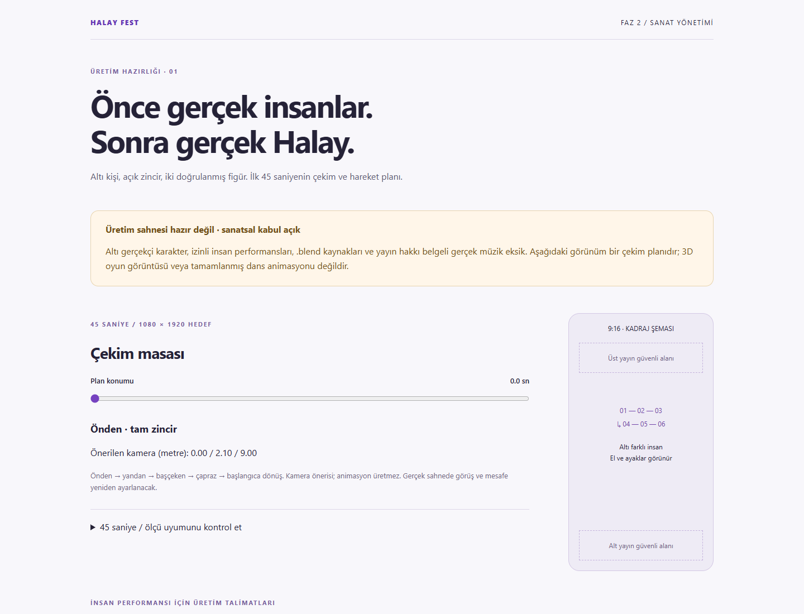

# Faz 2 sinematik sanat revizyonu — ilk teslim

**15 Kasım 2026 · Üretim/sanatsal kabul açık, PR taslak.** Başlangıç `feat/phase-2-visual-choreography-review` / `e2c0a32c2952b9dedc7fa262442f0c1c2858b81d`; geliştirme `feat/phase-2-cinematic-art-reset`.

## Somut sonuç

Mevcut varlıklar tekrar incelendi. İki Quaternius gövdesi, genel peasant kıyafetler, prosedürel eski karakter ve iki mühendislik temas çalışması kullanıcı tarafından istenen altı farklı gerçekçi kişi/iki gerçek Halay figürünü karşılamıyor. Eski sinüs klipleri insan performansı değildir; yeni waypoint-bake çalışmalarının da mocap veya uzman onaylı Halay kaynağı yoktur. Önceki ön/yan oyun görüntüleri ve 16 saniyelik video `docs/evidence/phase-2-revision/` altında tarihsel/reddedilmiş kanıt olarak kalır; bu revizyonun görsel başarısı diye kullanılmaz.

Mevcut gerçek ön/yan PNG'ler yeniden görsel olarak incelendi: aynı iki yüz/saç/kıyafet üçer kez tekrarlanıyor; yakın düğün hissi yerine geniş gökyüzü ve boş zemin kadrajı baskılıyor. Yandan döşeme platformunun kesit kenarı açıkta, mimari düz malzemeli; müzisyen ve mendilli başçeken görünmüyor. El işaretçilerinin yakınlığına rağmen parmak kavraması görsel olarak doğrulanmıyor. Tek kareden ayak sırasının veya ağırlık aktarımının doğru olduğu söylenemez. Bu bulgular eski sahnenin renklerini değiştirmenin yeterli olmadığını destekliyor.

Hazırlananlar:

- [ART_BIBLE](ART_BIBLE.md): insan/anatomi, rig, kıyafet, ortam, ışık, çekim, ölçüm ve açık kabul standardı.
- [ASSET_REGISTER](ASSET_REGISTER.md): mevcut varlıkların izin/kalite ayrımı, gerekli altı model, iki performans, kaynak .blend, müzik ve çevre teslimleri; aday kaynakların doğrulama sınırı.
- [DANCE_RESEARCH](DANCE_RESEARCH.md): erkek/kadın Halay, Kolbastı, pop ve oyun havası için kaynaklı araştırma. İki Halay aday tarifi, iki Kolbastı motifi, iki oyun havası araştırma görevi, iki özgün pop sayım taslağı kodlandı. **Bunlar sekiz oynatılabilir animasyon değildir.** Kadın hareketleri erkek kaydı ölçeklenerek üretilmez.
- [TECHNICAL_PLAN](TECHNICAL_PLAN.md): korunacak müzik/gateway mimarisi ve gerçek varlıkların import/retarget/temas/çekim sırası.
- Çalışan `/cinematic.html`: masaüstü/mobil hazırlık panosu; araştırma filtresi, erkek/kadın çekim talimatları, elle gezilen 45 saniyelik kamera planı ve gerçek grid sağlandığında ölçü/sekans aritmetiği.

Kamera kodu medya zamanı girdisine göre deterministiktir; seek/pause/döngü sınırı test edildi. **Henüz 3D kameraya veya gerçek müziğe bağlanmadı.** Sayfada eski modele/test sesine fallback, animasyon oynatımı veya nihai video kayıt düğmesi yok. Genel bir dosya/lisans onay motoru eklendiği iddia edilmez.

## Doğrulama

| Komut / kontrol | Sonuç |
|---|---|
| `npm ci` | Geçti; 173 paket, 181 audit, 0 bildirilen güvenlik açığı. Önce yalnız bu deponun açık dev/gateway süreçleri kapatıldı; kullanıcı müzikleri korundu. |
| `npm run verify` | Lint, strict typecheck, **66/66 unit/entegrasyon**, paket/gateway ve tüm Vite build'leri geçti. Önceki 61 + 5 yeni plan/ön kontrol/brief testi. |
| `npm run check:legacy` | Kaynak varlığı geçti; kendi raporu runtime verification yapılmadığını açıklar. Ayrı eski tarayıcı regresyonları aşağıdaki koşuya dahildir. |
| `npm run test:e2e` | **18 geçti, 3 opt-in uzun/GPU testi atlandı; 3,5 dk**, retry yok. Yeni hazırlık için iki test + önceki 16 regresyon. |
| `$env:TEST_PRODUCTION='1'; npm run test:e2e` | **18 geçti, 3 opt-in uzun/GPU testi atlandı; 3,4 dk**, retry yok. |
| Gerçek Chromium önizleme | 1440×1100 masaüstü, 390×844 mobil, iki Halay brief'i görüntülendi; 0 page error. Yeni sayfa GLB/FBX veya ses istemez. |

Eski müzik upload/decode, liste/metadata kalıcılığı, otomatik parça geçişi, panel kapanırken ses/render devamı, mock yorum/takip/hediye, socket tekrar bağlanma ve eski Halay/Horon kontrolleri regresyon kapsamındadır. Önceki sahnenin testte çalışması sanatsal onay değildir. E2E ayrı `data/e2e.sqlite` ve port offset 10000 kullanır. Yeni bağımlılık veya üçüncü taraf sanat varlığı eklenmedi.

## Gerçek ekran kanıtı — yalnız hazırlık sayfası

[Mobil](../evidence/cinematic-preparation/preparation-mobile.png) · [İki Halay üretim tarifi](../evidence/cinematic-preparation/halay-briefs.png) · [Yakalama metadata'sı](../evidence/cinematic-preparation/capture.json).

Bunlar çalışan HTML/TypeScript uygulamasının gerçek Chromium ekran görüntüleridir; 3D oyun, insan model kalitesi veya halay hareketi kanıtı değildir. Uygulama içi Browser bağlantısı `missing sandboxPolicy` ortam hatası verdi; bağımsız Chromium/Playwright kullanıldı. Tarih metadata'sı UTC, rapor tarihi İstanbul yerel saatidir.

## Tamamlanmayan kabul koşulları

| Koşul | Durum ve neden |
|---|---|
| Altı farklı gerçekçi kişi, yöresel kıyafet, doğal el/ayak/yüz | Eksik; onaylı yeni model seti yok. |
| İki gerçek Halay klibi, insan referansı ve ticari uyarlama/dağıtım hakları | Eksik; web öğretim kaynağı veya YouTube linki lisanslı mocap teslimi değildir. |
| Blender kaynakları ve gerçek GLB/FBX teslim doğrulaması | Eksik; yeni .blend/FBX/performans GLB'si yok. Mevcut importer testleri bunların yerine geçmez. |
| Gerçek müzik, yayın/video/master izinleri | Eksik; kullanıcıya özel dosyalar izinli ortak test müziği kabul edilmedi. Kalibrasyon sesi yerine konmadı. |
| Gerçekçi düğün meydanı, müzisyenler, mendil animasyonu | Eksik; sanat standardı/üretim planı hazır. |
| Yeni altılı sahne, ön/yan/sinematik görüntüler, ayak tabanı/el mesh hatası ve gerçek müzik sync ölçümü | **Yapılmadı**; gerekli performans/model/müzik seti yok. Önceki IK marker artık ölçümleri yeni biyomekanik kanıt sayılmadı. |
| 45 saniye gerçek sesli prototip videosu, kesintisiz hareket ve ses dikişi | **Üretilmedi.** Eski çalışmayı uzatarak eksik teslim gizlenmedi. |
| Yeni altılı FPS/kare süresi, 60 FPS, 5 saat dayanıklılık | **Ölçülmedi / garanti yok.** Önceki GPU rakamları yeni sahne için tekrar kullanılmadı; 100/106 profil koşusu yapılmadı. |
| Kullanıcı görsel onayı / yöresel uzman onayı | Açık. Faz 2 tamamlandı denmedi; Faz 3 veya gerçek TikTok yok. |

## Yerel inceleme ve sonraki somut iş

Depo kökünde `npm ci`, `npm run dev`. Hazırlık http://127.0.0.1:5173/cinematic.html; müzik paneli http://127.0.0.1:5174/#music; eski teknik referans http://127.0.0.1:5173/review.html. Yeni sayfa mevcut paneli/çalmakta olan müziği kontrol etmez. Build için `npm run build`, `npm start`; hazırlık portu 4174.

Sonraki iş: ART_BIBLE/ASSET_REGISTER'a göre altı karakter, iki icracı take'i ve eğitmen onayı, .blend + bake edilmiş iki klip ve izinli müzik teslimini temin etmek; ardından aynı altılı zincirde gerçek sahne/ölçüm/45 saniye kayıt üretmek. Diğer danslar bu turda yalnız araştırma olarak kaldı. PR, sanatsal kabul açıkken taslak kalmalıdır.
